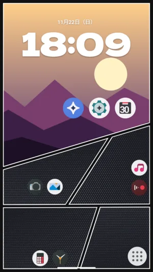
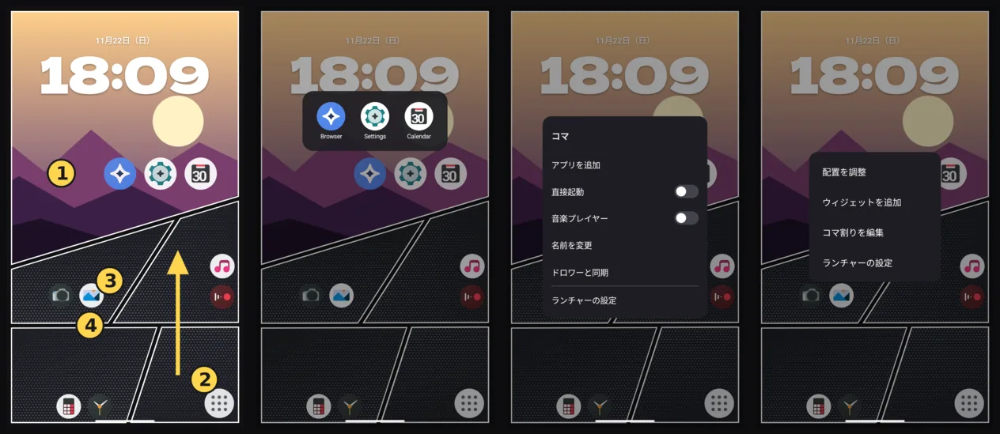
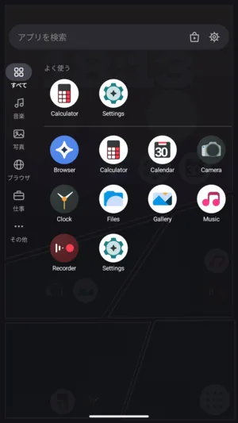
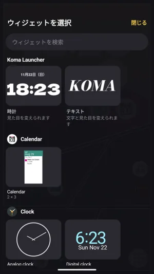
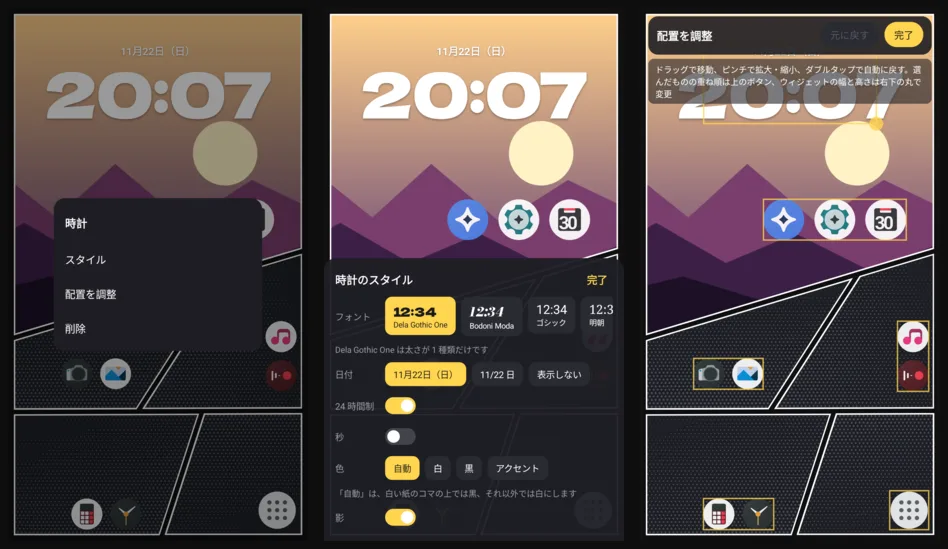
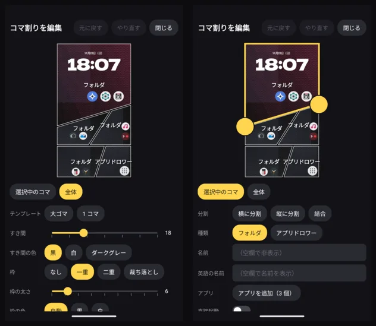
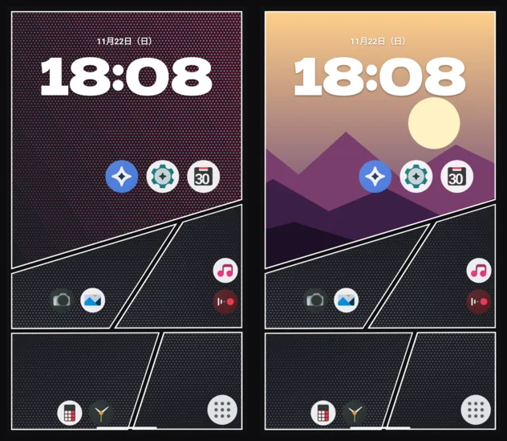

# koma-launcher

漫画のコマ割りの形でホーム画面を区切る Android のホームアプリ。コマは線で割ることを繰り返して作り、コマごとに別の画像を置く。コマを押すとアプリの一覧（フォルダ）が開く。ウィジェットはコマから独立して、時計と同じく画面の好きな位置に置ける。

動作を確認した実機は POCO X7 Pro（1220×2712、HyperOS、Android 15 以降）。開発中は Waydroid（Android 13、1080×1920）でも確認している。

> An Android home-screen launcher that divides the screen into manga-style panels. Each panel holds its own picture and opens an app folder; widgets float freely above the panels. The UI and documentation are in Japanese. Licensed under MIT.

## 状態

作者が自分の端末で使うために作ったアプリで、リリースはすべてプレリリース。ほかの端末でも動作するはずだが、確認していない。画像は同梱していない。初めて開くと、トーンを貼った黒ベタのコマ 5 つと時計が表示され、コマを押すと、電話・ブラウザ・カメラや、連絡先・メッセージなどの入ったフォルダが開く。

## 使い始める

1. [Releases](https://github.com/FuruNov/koma-launcher/releases) から最新の APK をダウンロードし、端末にインストールする。
2. 端末の設定の「デフォルトのアプリ」→「ホームアプリ」で Koma Launcher を選ぶ。
3. ホームのコマの間の余白を長押しし、「コマ割りを編集」でコマを分割して画像を選ぶ。

使う権限は次のとおり。どれも、使う機能をオンにしたときだけ求める。

| 権限 | 使う機能 |
|---|---|
| 通知へのアクセス | 音楽プレイヤーのコマ（再生中のアプリと曲のジャケットを知るため。通知の中身は読まない） |
| マイク | 設定の「音に合わせて動かす」（ビジュアライザーの棒を音に合わせる。録音はしない） |

ブラウザから APK をインストールした場合は、通知へのアクセスを許可する前に、アプリ情報の右上のメニューから「制限付き設定を許可」を選ぶ。

起動回数とバックアップは端末の内部と利用者が選んだフォルダにだけ保存し、ネットワークへは何も送らない（`INTERNET` の権限を持たない）。

## ホームの操作

1. コマを押すと、フォルダが開く。コマのアイコンを押すと、そのアプリを直接起動する
2. 上へスワイプすると、アプリドロワーが開く
3. コマを長押しすると、アプリの追加・直接起動・音楽プレイヤー・名前・ドロワーとの同期を変えるメニューが開く
4. コマの間の余白を長押しすると、配置の調整・ウィジェットの追加・コマ割りの編集・設定へ進むメニューが開く

アプリをフォルダに入れるには、アプリドロワーのアイコンを長押しして、ホームのコマまでドラッグする。フォルダの中ではドラッグで並べ替え、上端の「フォルダから削除」までドラッグするとフォルダから外れる。

## アプリドロワー

アプリは種類ごとのフォルダに自動で分かれ、左の列で切り替える。フォルダが多いと、入りきらない分は下の行に並ぶ（L 字）。検索欄では名前の一部やローマ字で検索でき、右端のアイコンで Play ストアと設定を開く。アプリを長押しすると、フォルダの変更や非表示を選べる。

## ウィジェットと時計

余白の長押しの「ウィジェットを追加」で、アプリごとにプレビューを並べた選択画面が開く。先頭の「Koma Launcher」には、このアプリに内蔵の時計とテキスト（大見出し）がある。

置いたウィジェットを長押しすると、メニューが開く（左）。時計とテキストは「スタイル」でフォント・太さ・日付・色を変えられる（中央）。「配置を調整」では、移動・サイズ変更と、人物の前後の切り替えができる（右）。

## コマ割りを編集する

余白の長押しの「コマ割りを編集」で開く。「選択中のコマ」のタブでコマを横か縦に分割し、黄色の丸を縁に沿って動かして線の角度を決める。「全体」のタブでは、すき間・枠・名前の書き方・視差を変える。

## コマに絵を入れる

編集画面でコマを選び、写真の選択画面から絵を選ぶ。絵はコマの形で切り取られる。人物の切り抜きを用意すると、時計や名前を人物の後ろに回せる。たくさんの絵をまとめて入れるときは、インポート用のフォルダ（`Android/data/dev.furunov.komalauncher/files/`）に `layout.json` と絵を置く（[layout.json の書き方](docs/layout-json.md)）。

## もっと詳しく

| 知りたいこと | 文書 |
|---|---|
| 各機能の詳しい動き（検索の絞り込み、アイコンの形、音楽プレイヤー、ホーム画面への追加など） | [docs/usage.md](docs/usage.md) |
| バックアップ、機種変更のときの復元 | [docs/usage.md の「バックアップと機種変更」](docs/usage.md#バックアップと機種変更) |
| layout.json の書き方、PC で作ったコマ割りの取り込み | [docs/layout-json.md](docs/layout-json.md) |
| ビルド、モジュールの構成、機能の追加、計測 | [docs/development.md](docs/development.md) |

AI のエージェント（Claude Code など）向けの作業手順を、`AGENTS.md` と `.claude/skills/` に置いた。

## ライセンス

コードと文書は MIT License（`LICENSE`）。次のものはそれぞれのライセンスに従う。

- `core/ui/src/main/res/font/` の書体 2 つ: SIL Open Font License 1.1（`licenses/`）
- `.claude/skills/` の Android の公式スキル 4 つ: Apache License 2.0（`.claude/skills/LICENSE.txt`）
